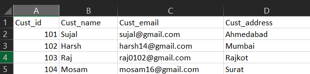
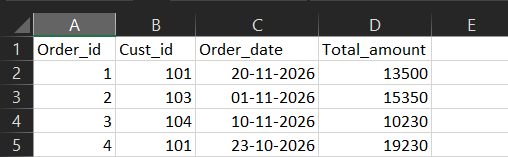
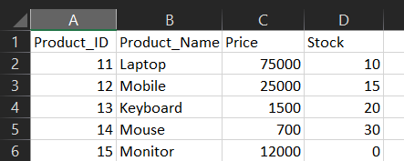
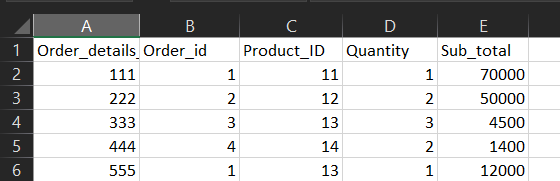
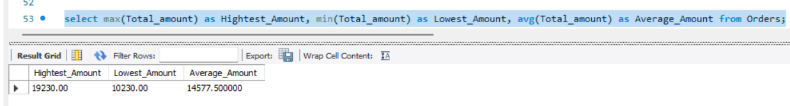
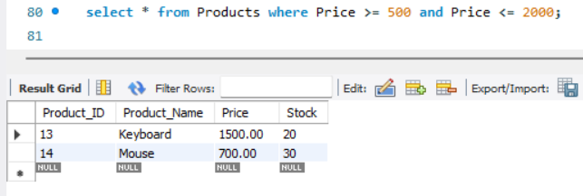
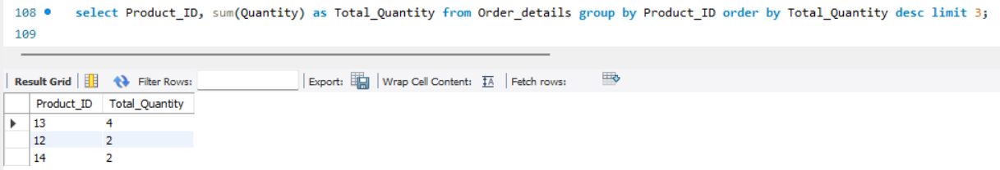

 <div align="center">

# 🗄️ Data Digger – SQL Database Management System

### Customer Order & Product Management Using MySQL

A SQL-based database management project developed using **MySQL**. This project demonstrates relational database creation, CRUD operations, primary keys, foreign keys, SQL constraints, aggregate functions, sorting, filtering, and table relationships.

<p>
  
  
  
  
</p>

**Create → Insert → Retrieve → Update → Delete → Analyze**

</div>

---

## 📌 Project Overview

**Data Digger** is a relational database management project developed using MySQL. It focuses on managing customer information, orders, product details, and order transactions through SQL queries.

The project consists of four relational tables:

1. **Customers** – Stores customer information.
2. **Orders** – Stores customer order information.
3. **Products** – Stores product details, prices, and stock.
4. **Order_details** – Stores order transactions, product quantities, and subtotals.

The project demonstrates practical SQL concepts, including CRUD operations, primary keys, foreign keys, aggregate functions, filtering, sorting, grouping, and database relationships.

## ✨ Features

| No. | Feature | Description |
|:---:|---|---|
| 1 | Database Creation | Create and select the Data_Digger database |
| 2 | Customers Management | Insert, retrieve, update, and delete customer records |
| 3 | Orders Management | Manage customer orders and order amounts |
| 4 | Products Management | Manage products, prices, and stock |
| 5 | Order Details | Store order transactions and product quantities |
| 6 | Primary Key | Uniquely identify records in each table |
| 7 | Foreign Key | Establish relationships between tables |
| 8 | WHERE Clause | Retrieve records using specific conditions |
| 9 | ORDER BY | Sort products and orders |
| 10 | Aggregate Functions | Calculate SUM, AVG, MAX, MIN, and COUNT |
| 11 | GROUP BY | Group product quantities |
| 12 | LIMIT | Retrieve the top 3 most ordered products |
| 13 | UPDATE | Modify existing database records |
| 14 | DELETE | Remove selected database records |

## 🧰 Technologies Used

- **MySQL** – Relational database management system.
- **SQL** – Database creation, management, and querying.
- **MySQL Workbench** – Writing and executing SQL queries.

## 📂 Project Structure

```text
📦 PR. 1 - Data Digger
│
├── 📂 assets
│   ├── 🖼️ Output-1.png
│   ├── 🖼️ Output-2.png
│   ├── 🖼️ Output-3.png
│   ├── 🖼️ Output-4.png
│   ├── 🖼️ Output-5.png
│   ├── 🖼️ Output-6.png
│   ├── 🖼️ Output-7.png
│   └── 🎥 Project Demonstration.mp4
│
├── 📄 Data_Digger.sql
│
└── 📄 README.md
```

## 🚀 How to Run the Project

### 1. Install MySQL

Install MySQL Server and MySQL Workbench.

### 2. Open MySQL Workbench

Open MySQL Workbench and connect to your MySQL server.

### 3. Open SQL File

Open the `Data_Digger.sql` file in MySQL Workbench.

### 4. Execute SQL Queries

Run the SQL queries in sequence to create the database, tables, and sample records.

### 5. Verify Database

Execute the following command:

```sql
USE Data_Digger;

SHOW TABLES;
```

To display all records:

```sql
SELECT * FROM Customers;
SELECT * FROM Orders;
SELECT * FROM Products;
SELECT * FROM Order_details;
```

## 🗂️ Database Tables

### 1. Customers Table

Stores customer information.

| Column | Data Type | Description |
|---|---|---|
| Cust_id | INT | Primary Key |
| Cust_name | VARCHAR(30) | Customer Name |
| Cust_email | VARCHAR(30) | Customer Email |
| Cust_address | VARCHAR(30) | Customer Address |

### 2. Orders Table

Stores customer order information.

| Column | Data Type | Description |
|---|---|---|
| Order_id | INT | Primary Key |
| Cust_id | INT | Foreign Key |
| Order_date | DATE | Order Date |
| Total_amount | DECIMAL(10,2) | Total Order Amount |

### 3. Products Table

Stores product information.

| Column | Data Type | Description |
|---|---|---|
| Product_ID | INT | Primary Key |
| Product_Name | VARCHAR(30) | Product Name |
| Price | DECIMAL(10,2) | Product Price |
| Stock | INT | Available Stock |

### 4. Order_details Table

Stores individual order and product transaction details.

| Column | Data Type | Description |
|---|---|---|
| Order_details_id | INT | Primary Key |
| Order_id | INT | Foreign Key |
| Product_ID | INT | Foreign Key |
| Quantity | INT | Product Quantity |
| Sub_total | DECIMAL(10,2) | Subtotal Amount |

## 🔗 Database Relationships

The project uses Primary Keys and Foreign Keys to connect four relational tables.

```text
          CUSTOMERS
              |
              | Cust_id
              |
              ▼
            ORDERS
              |
              | Order_id
              |
              ▼
         ORDER_DETAILS
              |
              | Product_ID
              |
              ▼
           PRODUCTS
```

**Relationships:**

- One customer can have multiple orders.
- One order can contain multiple order details.
- One product can appear in multiple order details.
- Foreign keys maintain relationships between the tables.

## 💻 SQL Operations Performed

### 1. Database Creation

```sql
CREATE DATABASE Data_Digger;

USE Data_Digger;
```

### 2. CRUD Operations

The project performs all four CRUD operations:

| Operation | SQL Command | Purpose |
|---|---|---|
| Create | INSERT | Add new records |
| Read | SELECT | Retrieve records |
| Update | UPDATE | Modify existing records |
| Delete | DELETE | Remove records |

### 3. Filtering and Sorting

```sql
-- Retrieve customer by name
SELECT * FROM Customers
WHERE Cust_name = 'Sujal';

-- Sort products by price
SELECT * FROM Products
ORDER BY Price DESC;

-- Retrieve products within a price range
SELECT * FROM Products
WHERE Price >= 500 AND Price <= 2000;
```

### 4. Aggregate Functions

The project uses the following aggregate functions:

| Function | Purpose |
|---|---|
| SUM() | Calculate total revenue |
| AVG() | Calculate average order amount |
| MAX() | Find highest value |
| MIN() | Find lowest value |
| COUNT() | Count records |

Example:

```sql
SELECT
MAX(Total_amount) AS Highest_Amount,
MIN(Total_amount) AS Lowest_Amount,
AVG(Total_amount) AS Average_Amount
FROM Orders;
```

### 5. Total Revenue

```sql
SELECT SUM(Sub_total) AS Total_Revenue
FROM Order_details;
```

### 6. Top 3 Most Ordered Products

```sql
SELECT Product_ID,
SUM(Quantity) AS Total_Quantity
FROM Order_details
GROUP BY Product_ID
ORDER BY Total_Quantity DESC
LIMIT 3;
```

### 7. Count Product Sales Records

```sql
SELECT COUNT(Order_id) AS Times_Sold
FROM Order_details
WHERE Product_ID = 11;
```

## 📷 Output Gallery

All project execution screenshots are available in the `assets` folder.

<div align="center">

| Output 1 | Output 2 |
|:---:|:---:|
|  |  |
| [View Output 1](assets/Output-1.png) | [View Output 2](assets/Output-2.png) |

| Output 3 | Output 4 |
|:---:|:---:|
|  |  |
| [View Output 3](assets/Output-3.png) | [View Output 4](assets/Output-4.png) |

| Output 5 | Output 6 |
|:---:|:---:|
|  |  |
| [View Output 5](assets/Output-5.png) | [View Output 6](assets/Output-6.png) |

### Output 7



[View Output 7](assets/Output-7.png)

</div>

## 🎥 Project Demonstration

Watch the complete project demonstration to understand database creation, SQL query execution, CRUD operations, and table relationships.

**Video:** `assets/Project Demonstration.mp4`

## 🎯 Learning Outcomes

By completing this project, students learn:

- Understanding relational databases and MySQL.
- Creating databases and tables.
- Performing CRUD operations.
- Using Primary Keys and Foreign Keys.
- Understanding database relationships.
- Applying WHERE, AND, and ORDER BY clauses.
- Using aggregate functions such as SUM, AVG, MAX, MIN, and COUNT.
- Grouping records using GROUP BY.
- Retrieving limited records using LIMIT.
- Managing customer, order, and product information using SQL.

## 📌 Project Snapshot

| Category | Details |
|---|---|
| Project Name | Data Digger |
| Project Number | PR. 1 |
| Database | Data_Digger |
| Language | SQL |
| DBMS | MySQL |
| Tables | Customers, Orders, Products, Order_details |
| Primary Concepts | CRUD, Keys, Constraints, Aggregates |
| IDE | MySQL Workbench |
| Output | SQL Query Results |

## 👨‍💻 Author

<div align="center">

### **Sujal Patel**

**SQL • MySQL • Database Management • CRUD Operations**

This project was developed as a practical exercise in relational database design, SQL query execution, and database management.

</div>

---

<div align="center">

### 🗄️ Data Digger

**Create • Manage • Retrieve • Analyze**

[⬆ Back to Top](#-data-digger--sql-database-management-system)

</div>